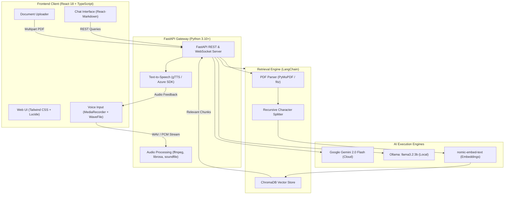

# 🧬 Bio-Assist AI: Multimodal Biology Research & Learning Assistant

[](https://reactjs.org/)
[](https://www.typescriptlang.org/)
[](https://fastapi.tiangolo.com/)
[](https://tailwindcss.com/)
[](https://www.langchain.com/)
[](https://www.trychroma.com/)
[](https://ai.google.dev/)
[](https://ollama.ai/)

**Bio-Assist AI** is a state-of-the-art multimodal artificial intelligence platform engineered specifically for biological sciences education, research acceleration, and document question-answering.

By bridging modern **Retrieval-Augmented Generation (RAG)** with real-time **voice interaction** and dual AI execution engines (cloud-based Google Gemini 2.0 and privacy-first local LLMs via Ollama), Bio-Assist AI provides researchers, educators, and students with an interactive, verified, and contextual academic copilot.

---

## 📑 Table of Contents

- [Key Features](#-key-features)
- [System Architecture](#-system-architecture)
- [Tech Stack](#-tech-stack)
- [Repository Structure](#-repository-structure)
- [Prerequisites](#-prerequisites)
- [Installation & Quickstart](#-installation--quickstart)
  - [1. Clone Repository](#1-clone-repository)
  - [2. Backend Setup](#2-backend-setup)
  - [3. Local LLM & Embedding Setup (Ollama)](#3-local-llm--embedding-setup-ollama)
  - [4. Frontend Setup](#4-frontend-setup)
- [Environment Configuration](#-environment-configuration)
- [API Documentation](#-api-documentation)
- [Troubleshooting & FAQs](#-troubleshooting--faqs)
- [Contributing](#-contributing)
- [License](#-license)

---

## ✨ Key Features

### 1. 🔍 Hybrid Retrieval-Augmented Generation (RAG)
- **Document Ingestion**: Extracts text directly from scientific publications, research notes, and comprehensive textbooks using **PyMuPDF (`fitz`)**.
- **Semantic Chunking**: Applies dynamic windowing via LangChain's `RecursiveCharacterTextSplitter` (1000-character chunks with 100-character overlap) to preserve scientific context across paragraph boundaries.
- **Vector Storage**: Employs **ChromaDB** with high-density vector representations generated by `nomic-embed-text` to enable ultra-fast cosine similarity retrieval.

### 2. 🎙️ Real-Time Multimodal Voice Copilot
- **Live Voice Interaction**: Interactive voice query interface equipped with speech visualization.
- **Audio Processing Pipeline**: Integrates `ffmpeg`, `librosa`, and `soundfile` for real-time audio downsampling, format conversion, and noise filtering.
- **Text-to-Speech (TTS)**: Built-in natural speech synthesis powered by `gTTS` and Azure Speech SDK for audible explanations of complex biological pathways.

### 3. 🌐 Dual-Engine AI Architecture
- **Cloud Power (Google Gemini 2.0 Flash)**: Extreme speed, reasoning, and multimodal capabilities through the latest `@google/genai` SDK.
- **Local Privacy (Ollama)**: Full offline privacy-preserving execution utilizing quantized models like `llama3.2:3b` for data-sensitive research environments.

### 4. 🎨 Modern Glassmorphic Web Interface
- Responsive, dark-themed UI built with **React 18**, **TypeScript**, and **Tailwind CSS**.
- Feature cards, dynamic conversation history, LaTeX/Markdown rendering for biological formulas and phylogenetic notation.
- Built-in drag-and-drop document uploader with progress indicators.

---

## 🏛 System Architecture



---

## 💻 Tech Stack

### Frontend
- **Framework**: [React 18.3](https://reactjs.org/) with [TypeScript](https://www.typescriptlang.org/)
- **Styling**: [Tailwind CSS](https://tailwindcss.com/), `tailwind-variants`, `tailwindcss-animate`
- **UI & Icons**: [Lucide React](https://lucide.dev/), [Radix UI](https://www.radix-ui.com/), Sonner toast notifications
- **Audio Handling**: `wavefile` client-side audio encoder
- **Formatting**: `react-markdown` for rendering scientific markdown, tables, and chemical/biological symbols

### Backend
- **Framework**: [FastAPI 0.104](https://fastapi.tiangolo.com/) with asynchronous request handling via [Uvicorn](https://www.uvicorn.org/)
- **RAG Orchestration**: [LangChain](https://www.langchain.com/) and `langchain-community`
- **Vector Database**: [ChromaDB](https://www.trychroma.com/) (persistent SQLite-backed local vector index)
- **PDF Extraction**: [PyMuPDF](https://pymupdf.readthedocs.io/) (`fitz`) for accurate multi-column text extraction
- **Audio & Signal Processing**: `ffmpeg-python`, `soundfile`, `librosa`, `numpy`
- **Text-to-Speech**: `gTTS` (Google Text-to-Speech) and Microsoft Azure Cognitive Speech SDK

### AI & Embeddings
- **Cloud LLM**: [Google Gemini 2.0 Flash](https://ai.google.dev/) via `google-genai` SDK
- **Local LLM**: [Ollama](https://ollama.ai/) running `llama3.2:3b`
- **Embeddings**: `nomic-embed-text` for high-dimensional document embedding

---

## 📂 Repository Structure

```text
bioassistant/
├── PDF/                         # Reference biology textbooks and research PDFs
│   ├── lebo101.pdf              # The Living World, Biological Classification
│   ├── lebo102.pdf              # Plant & Animal Kingdoms
│   └── ...                      # Comprehensive curriculum modules (lebo103-113)
├── chroma_store/                # Pre-indexed persistent vector database
│   └── 88f0d36a-.../            # Hierarchical Navigable Small World (HNSW) binary graphs
├── public/                      # Static assets & HTML entry point
│   └── index.html
├── src/                         # Application source code
│   ├── backend/                 # FastAPI server and Python RAG services
│   │   ├── fastapi_server.py    # Main API gateway, endpoints, audio & Gemini integration
│   │   ├── start_server.py      # Server launcher script
│   │   ├── requirements.txt     # Python dependencies
│   │   └── chroma_store/        # Backend-specific vector persistence
│   ├── components/              # React UI components
│   │   ├── ChatInterface.tsx    # Interactive message thread with Markdown rendering
│   │   ├── DocumentList.tsx     # Display of ingested reference documents
│   │   ├── FeatureCards.tsx     # Quick-start action cards
│   │   ├── FileUpload.tsx       # Drag-and-drop PDF ingestion
│   │   ├── Header.tsx           # Navigation bar with model status indicator
│   │   ├── SearchBar.tsx        # Fast filter search
│   │   └── VoiceInput.tsx       # Microphone audio recording and streaming
│   ├── context/
│   │   └── ChatContext.tsx      # Global React chat and session state
│   ├── hooks/                   # Custom React hooks (toast, audio)
│   ├── rag_app.py               # Core LangChain RAG pipeline & PyMuPDF extractor
│   ├── index.tsx                # Frontend application entry point
│   ├── index.css                # Global CSS styles and design tokens
│   └── tailwind.config.js       # Tailwind CSS theme configuration
├── .env.example                 # Template for required environment variables
├── .gitignore                   # Git exclusion rules for secrets, virtual environments, and caches
├── package.json                 # Node.js project manifest & scripts
├── tsconfig.json                # TypeScript compiler options
└── README.md                    # Project documentation
```

---

## ⚙️ Prerequisites

Before getting started, ensure you have the following installed on your system:

1. **Node.js**: v18.0.0 or higher ([Download Node.js](https://nodejs.org/))
2. **Python**: v3.10 or v3.11 ([Download Python](https://www.python.org/))
3. **FFmpeg**: Required for audio transcoding and speech input
   - **macOS**: `brew install ffmpeg`
   - **Ubuntu/Debian**: `sudo apt update && sudo apt install ffmpeg`
   - **Windows**: `winget install Gyan.FFmpeg` or download from [ffmpeg.org](https://ffmpeg.org/)
4. **Ollama** *(Optional, for offline AI)*: [Download Ollama](https://ollama.ai/)
5. **Google AI Studio API Key**: For Gemini 2.0 Flash ([Get API Key](https://aistudio.google.com/))

---

## 🚀 Installation & Quickstart

### 1. Clone Repository
```bash
git clone https://github.com/Nishannt-X/Bio-Assist_AI.git
cd Bio-Assist_AI
```

### 2. Backend Setup

Create and activate an isolated Python virtual environment:

```bash
# macOS / Linux
python3 -m venv venv
source venv/bin/activate

# Windows (Command Prompt / PowerShell)
python -m venv venv
venv\Scripts\activate
```

Install backend requirements:
```bash
pip install --upgrade pip
pip install -r src/backend/requirements.txt
pip install PyMuPDF gTTS soundfile librosa
```

Configure your environment variables:
```bash
cp .env.example .env
```
Open `.env` in your text editor and add your Gemini API key:
```ini
GEMINI_API_KEY=AIzaSyYourGeminiApiKeyHere
```

Start the FastAPI backend server:
```bash
# Run server using the startup script
python src/backend/start_server.py

# Or directly with Uvicorn:
uvicorn src.backend.fastapi_server:app --host 0.0.0.0 --port 8000 --reload
```
The API documentation will now be available interactively at **`http://localhost:8000/docs`**.

---

### 3. Local LLM & Embedding Setup (Ollama)

If you plan to use local models alongside or instead of Google Gemini:

```bash
# Start Ollama service
ollama serve

# In a separate terminal, pull the required models:
ollama pull llama3.2:3b
ollama pull nomic-embed-text
```

---

### 4. Frontend Setup

Open a new terminal window in the project root:

```bash
# Install frontend dependencies
npm install

# Start development server
npm start
```

The React web application will automatically open at **`http://localhost:3000`**.

---

## 🔐 Environment Configuration

Create a `.env` file in the root directory (based on `.env.example`):

| Variable | Required | Default | Description |
| :--- | :---: | :---: | :--- |
| `GEMINI_API_KEY` | **Yes** | — | Google AI Studio Gemini API Key for Gemini 2.0 Flash |
| `OLLAMA_BASE_URL` | No | `http://localhost:11434` | Base endpoint for local Ollama instance |
| `CHROMA_PERSIST_DIR` | No | `./chroma_store` | Path to persistent ChromaDB storage directory |
| `AZURE_SPEECH_KEY` | No | — | Optional Microsoft Azure Cognitive Speech API key |
| `AZURE_SPEECH_REGION` | No | — | Optional Azure service region (e.g. `eastus`) |

> ⚠️ **Security Notice**: Never commit `.env` or your private keys to source control. They are strictly excluded in `.gitignore`.

---

## 📡 API Documentation

FastAPI automatically provides interactive Swagger documentation at `http://localhost:8000/docs`. Key endpoints include:

| Method | Endpoint | Description |
| :--- | :--- | :--- |
| `POST` | `/ask` | Submits a biological query; retrieves context from ChromaDB and returns an AI synthesis |
| `POST` | `/voice-chat` | Accepts raw PCM/WAV audio data, transcribes query, generates answer, and returns synthesized audio stream |
| `POST` | `/upload-pdf` | Ingests new PDF documents into the vector store via PyMuPDF and text chunking |
| `GET` | `/documents` | Returns a list of currently indexed biological reference texts and chunk metrics |
| `GET` | `/health` | Server heartbeat and status verification |

---

## 🛠️ Troubleshooting & FAQs

### 1. `GEMINI_API_KEY` environment variable missing
Ensure that you have created a `.env` file containing `GEMINI_API_KEY=your_key` and that the backend process has read access to it.

### 2. FFmpeg not found during audio recording
The audio processing pipeline depends on the system `ffmpeg` binary. Ensure `ffmpeg` is installed and available in your system `$PATH` (`ffmpeg -version`).

### 3. ChromaDB SQLite Error on older systems
ChromaDB requires SQLite version `3.35.0` or higher. If you encounter an error on older Linux distributions, install `pysqlite3-binary` and configure it in your python environment.

### 4. Port Conflicts
- Default Frontend: `http://localhost:3000`
- Default Backend: `http://localhost:8000`
- If port 8000 is occupied, run `uvicorn src.backend.fastapi_server:app --port 8001` and update your frontend API configuration.

---

## 🤝 Contributing

Contributions to Bio-Assist AI are welcome! Whether it's adding new biological ontology datasets, improving speech recognition, or enhancing RAG retrieval accuracy:

1. Fork the Project
2. Create your Feature Branch (`git checkout -b feature/NewBioFeature`)
3. Commit your Changes (`git commit -m 'feat: Add support for PubMed document retrieval'`)
4. Push to the Branch (`git push origin feature/NewBioFeature`)
5. Open a Pull Request

---

## 📄 License

This project is licensed under the MIT License — see the [LICENSE](LICENSE) file for details.
